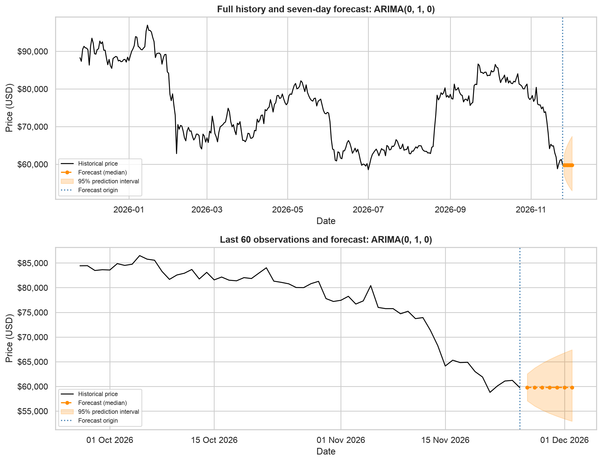

# Bitcoin Seven-Day Price Forecast with ARIMA

Predicting the price movement of Bitcoin for the next 7 days from one year of daily
[Blockchain.com market-price data](https://www.blockchain.com/ko/charts/market-price), using ARIMA in Python.

## Result (data retrieved 25 November 2026)

| Item | Value |
|---|---|
| Selected model | ARIMA(0,1,0) on log price (random walk) |
| Forecast, 26 Nov to 2 Dec 2026 | **Neutral**, flat at **$59,742.21** |
| 95% interval on day 7 | $52,944 to $67,414 |
| One-day-ahead test MAPE | 1.51% |

The model has **no predictive skill beyond the naive forecast**. This is academic work, not investment advice.



## Quick start

```bash
git clone https://github.com/MMNayon00/ARIMA-nodel.git
cd ARIMA-nodel/bitcoin_arima_forecasting
./run_all.sh
```

The script creates a virtual environment if needed and takes about 10 to 15 minutes. It was tested with
Python 3.14 on macOS. Running it rebuilds the notebook and the Word report.

## Where to find everything

| What | Location |
|---|---|
| Full instructions | [Project README](bitcoin_arima_forecasting/README.md) |
| Academic report | [report/](bitcoin_arima_forecasting/report/) |
| Notebook with outputs | [bitcoin_arima_analysis.ipynb](bitcoin_arima_forecasting/notebooks/bitcoin_arima_analysis.ipynb) |
| Seven-day forecast | [seven_day_forecast.csv](bitcoin_arima_forecasting/results/seven_day_forecast.csv) |
| Model evaluation | [model_evaluation.csv](bitcoin_arima_forecasting/results/model_evaluation.csv) |
| Graphs | [outputs/](bitcoin_arima_forecasting/outputs/) |
| Dataset | [bitcoin_historical_data.csv](bitcoin_arima_forecasting/data/bitcoin_historical_data.csv) |
| Source code | [src/](bitcoin_arima_forecasting/src/) |
